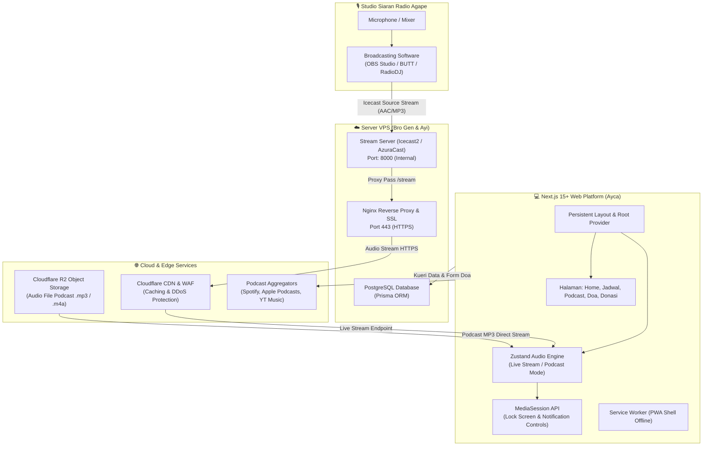
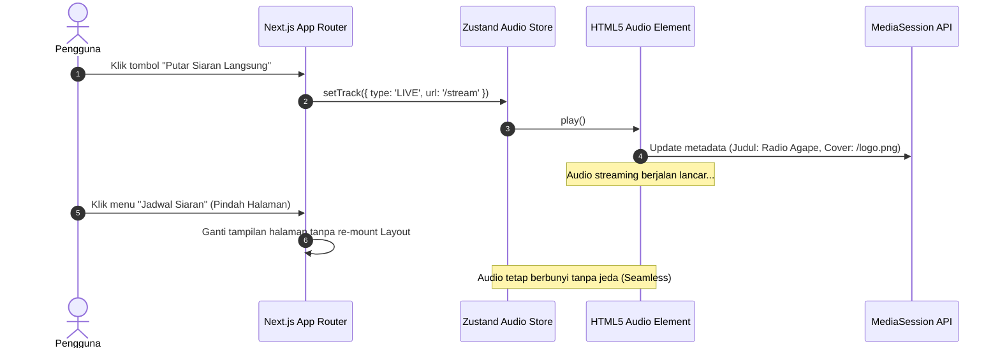
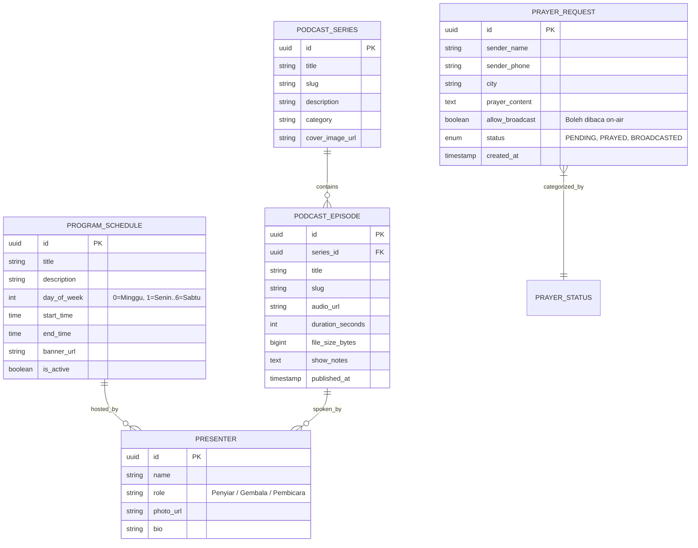

# 🏗️ System Architecture & Streaming Blueprint
## Website Radio Agape: Platform Streaming Audio 24/7 & Podcast

* **Repository GitHub**: `TrickPatMK/radio-agape-giap`
* **Dokumen Terkait**: `[[Radio-Agape/_MOC - Radio Agape|MOC Radio Agape]]`, `[[Radio-Agape/PRD - Radio Agape|PRD Radio Agape]]`

---

## 1. Ikhtisar Rekomendasi Arsitektur

Arsitektur sistem Website Radio Agape dirancang dengan prinsip:
1. **Uninterrupted Audio Playback**: Pengguna bebas menjelajahi halaman tanpa gangguan putus suara (memanfaatkan App Router Client State / Persistent Layout).
2. **Bandwidth & CDN Efficiency**: Mengurangi beban streaming server utama dengan memanfaatkan reverse proxy SSL dan caching audio segment.
3. **Penyimpanan Podcast Hemat Biaya**: Menggunakan Cloudflare R2 (S3 compatible dengan nol biaya transmisi/egress data) untuk file audio podcast yang berukuran besar.
4. **Distribusi Tugas Modular Antar Agen**: Ayca (Frontend/Client), Ayi (Backend & DB), Bro Gen (Server/Streaming Relay).

---

## 2. Diagram Arsitektur Keseluruhan (System Topology)



---

## 3. Komponen Teknologi yang Direkomendasikan

| Lapisan Sistem | Teknologi Pilihan | Alasan Pemilihan |
| :--- | :--- | :--- |
| **Frontend Framework** | **Next.js 15+ (App Router)** | Rendering hybrid (SSR untuk halaman podcast & SEO, Client Component untuk persistent audio player), performa tinggi, dan ekosistem React modern. |
| **Styling & UI Components** | **Tailwind CSS + Shadcn UI** | Komponen ringan, mudah dikustomisasi, estetis, responsif mobile-first, dan aksesibilitas tinggi (Radix Primitives). |
| **Audio Player State** | **Zustand + HTML5 Audio / Howler.js** | Manajemen status pemutar global yang ringan. Mencegah re-render yang tidak perlu saat berpindah route/halaman. |
| **Mobile Integration** | **Web MediaSession API + PWA** | Menampilkan judul siaran dan tombol play/pause di lockscreen smartphone; kemampuan instalasi ke home screen tanpa app store. |
| **Streaming Engine** | **Icecast2** atau **AzuraCast** | Standar industri radio internet global; sangat stabil, mendukung metadata ICY (Now Playing), konsumsi RAM sangat rendah (< 100MB). |
| **Backend API & ORM** | **Next.js Server Actions + Prisma ORM** | Mengurangi kerumitan server terpisah untuk tahap MVP; tipe data aman (*end-to-end type safety*) dengan TypeScript. |
| **Database** | **PostgreSQL** | Standar industri untuk data relasional, integritas data tinggi untuk jadwal, podcast, permohonan doa, dan pengguna admin. |
| **Object Storage (Podcast)** | **Cloudflare R2** | Kompatibel dengan protokol AWS S3, namun memiliki keunggulan **$0 Egress Fee** (gratis biaya bandwidth pengunduhan audio). |
| **Reverse Proxy & SSL** | **Nginx + Let's Encrypt** | Menangani sertifikat SSL/TLS HTTPS untuk stream audio dan API agar browser tidak memblokir audio (*no mixed-content*). |

---

### 3.1 Endpoint Live Server Siaran Eksisting (Agape FM Semarang)
Berdasarkan audit infrastruktur live pada `http://agapefm.com/`, server Icecast riil stasiun telah aktif dan terhubung:
* **Host Streaming**: `http://radio.agapefm.com:8000`
* **Status Telemetri JSON**: `http://radio.agapefm.com:8000/status-json.xsl`
* **Saluran Siaran Aktif**:
  1. `/agapelive`: Siaran Utama 94.5 FM Studio Live (`http://radio.agapefm.com:8000/agapelive`)
  2. `/alkitab.ogg`: Pembacaan Alkitab Suara 24 Jam (`http://radio.agapefm.com:8000/alkitab.ogg`)
  3. `/khotbahpujian.ogg`: Khotbah & Pujian Penyejuk Hati (`http://radio.agapefm.com:8000/khotbahpujian.ogg`)
  4. `/pujian.ogg`: Musik Pujian Nonstop (`http://radio.agapefm.com:8000/pujian.ogg`)
  5. `/dkjlive`: Stream Format MP3 untuk kompatibilitas peramban lawas
* **Internal Next.js Proxy Route**: `/api/stream-status` (menghindari isu CORS dan menyajikan telemetri jumlah listener aktual ke Studio Cockpit).

---

## 4. Rincian Arsitektur Pemutar Audio (Audio Player Subsystem)

### 4.1 Mekanisme Persistent Player (Tanpa Putus)
Pada aplikasi Next.js standar, navigasi antar halaman dapat memuat ulang komponen DOM. Untuk memastikan siaran radio 24/7 tidak mati:
* Pemutar ditempatkan di dalam `app/layout.tsx` di bawah `AudioPlayerProvider`.
* Komponen halaman (`app/page.tsx`, `app/jadwal/page.tsx`, dll.) hanya merender konten di dalam area `<main>`.
* Saat pengguna berpindah halaman, hanya node DOM halaman yang berganti, sementara `<audio>` element dan state Zustand tetap berjalan di latar belakang.



### 4.2 Integrasi MediaSession API
```typescript
// Konseptual implementasi di sisi Ayca (Client)
if ('mediaSession' in navigator) {
  navigator.mediaSession.metadata = new MediaMetadata({
    title: currentTrack.title || 'Radio Agape - Live On Air',
    artist: currentTrack.artist || '24/7 Rohani & Pujian',
    album: 'Radio Agape Streaming',
    artwork: [
      { src: '/icons/radio-agape-192.png', sizes: '192x192', type: 'image/png' },
      { src: '/icons/radio-agape-512.png', sizes: '512x512', type: 'image/png' },
    ]
  });

  navigator.mediaSession.setActionHandler('play', () => audioStore.play());
  navigator.mediaSession.setActionHandler('pause', () => audioStore.pause());
}
```

---

## 5. Skema Basis Data (Database Entity Blueprint)



---

## 6. Pembagian Peran Tim Agen (Team Synergy)

Sesuai dengan hierarki ekosistem agen:

```mermaid
flowchart LR
    subgraph Ayca_Local["🌸 Ayca (PC Lokal)"]
        A1["Next.js App & UI/UX"]
        A2["Zustand Persistent Audio Player"]
        A3["PWA & MediaSession Integration"]
        A4["Komponen Jadwal & Form Doa"]
    end

    subgraph Ayi_VPS["💻 Ayi (VPS Remote)"]
        B1["Skema Prisma / PostgreSQL"]
        B2["Server Actions & Admin CMS"]
        B3["Podcast RSS Generator (.xml)"]
        B4["Icecast ICY Metadata Fetcher"]
    end

    subgraph BroGen_VPS["👑 Bro Gen (VPS Ops)"]
        C1["Setup Server Icecast2 / AzuraCast"]
        C2["Nginx HTTPS Reverse Proxy"]
        C3["Cloudflare CDN & SSL Configuration"]
        C4["Monitoring Uptime 24/7"]
    end

    Ayca_Local <-->|Sinkronisasi API & Repo GitHub| Ayi_VPS
    Ayi_VPS <-->|Konfigurasi Host & Port Relay| BroGen_VPS
```



* **Ayca (Local Dev)**: Membangun fondasi frontend di repositori lokal `radio-agape-giap`, menyusun desain antarmuka, memastikan pengalaman pemutaran audio di perangkat mobile dan desktop berjalan tanpa cela.
* **Ayi (VPS Dev)**: Menyiapkan model data, API endpoint, integrasi Cloudflare R2 untuk penyimpanan podcast, serta pipeline metadata streaming langsung.
* **Bro Gen (VPS Ops)**: Mengatur kontainer/layanan Icecast di VPS, mengonfigurasi sertifikat SSL, dan mengawasi kesehatan server siaran.

---

## 7. Rencana Keamanan & Keandalan (Reliability & Security)

1. **Anti-CORS & Mixed Content**:
   * Seluruh streaming URL disalurkan melalui subdomain aman (contoh: `https://stream.radioagape.com/live`) dengan sertifikat SSL valid agar tidak diblokir browser Chrome/Safari modern.
2. **Anti-Spam Form Doa**:
   * Penerapan Cloudflare Turnstile / reCAPTCHA v3 transparan pada formulir permohonan doa untuk mencegah bot kirim massal.
3. **Audio Fallback Standby**:
   * Apabila sambungan studio utama mati atau listrik padam, AutoDJ di Icecast/AzuraCast otomatis memutar cadangan daftar putar rohani secara mandiri sehingga siaran tidak pernah sunyi (*dead air*).
