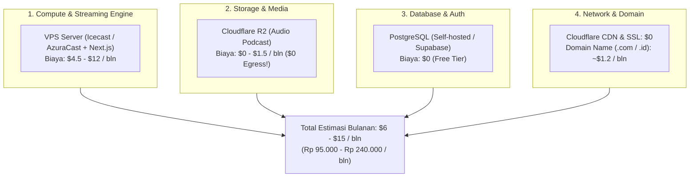

---
title: "Analisis Biaya & Estimasi Budget End-to-End: Radio Agape"
type: architecture
tags:
  - project/radio-agape
  - cost-analysis
  - budget
  - infrastructure
created: 2026-09-08
updated: 2026-09-08
up: "[[Radio-Agape/_MOC - Radio Agape]]"
---

# 💰 Analisis Biaya & Estimasi Budget End-to-End
## Platform Website Streaming 24/7 & Podcast Radio Agape

* **Repository GitHub**: `TrickPatMK/radio-agape-giap`
* **Dokumen Terkait**: `[[Radio-Agape/_MOC - Radio Agape|MOC Radio Agape]]`, `[[Radio-Agape/PRD - Radio Agape|PRD Utama]]`, `[[Radio-Agape/Architecture - Radio Agape|Arsitektur Sistem]]`

---

## 1. Asumsi Beban Kerja & Trafik Siaran

Untuk menghitung biaya secara realistis, kita membagi metrik penggunaan ke dalam parameter standar penyiaran audio:

| Parameter | Spesifikasi Teknis | Kebutuhan Data per Pendengar |
| :--- | :--- | :--- |
| **Kualitas Stream Audio** | AAC+ 64 kbps (Hemat Kuota) atau MP3 128 kbps (Standar Prima) | 64 kbps = ~28.8 MB/jam 128 kbps = ~57.6 MB/jam |
| **Rata-rata Durasi Dengar** | 1 jam / sesi | ~28.8 MB / sesi (pada 64 kbps) |
| **Podcast Khotbah / Renungan** | 1 episode = ~30 menit (file audio ~20 - 30 MB) | 1.000 unduhan episode = ~25 GB bandwidth |
| **Trafik Web & CMS** | Halaman website, jadwal, dan prayer request | ~50.000 - 100.000 pageviews/bulan |

---

## 2. Perincian Biaya per Komponen Arsitektur

### 2.1 Server Siaran (Icecast/AzuraCast) & Web Application (Compute)
* **Kebutuhan**: Server Linux untuk menjalankan Icecast2 / AzuraCast relay dan aplikasi Next.js (bisa dideploy mandiri via Docker / Node.js).
* **Pilihan Provider**:
  * **Hetzner Cloud (CX22 / CPX21)**: 2-3 vCPU, 4GB RAM, 40GB NVMe, **20 TB Bandwidth Gratis**.
    * Biaya: **~€4.00 - €7.00 / bulan** (~$4.50 - $7.50 / bulan).
  * **Contabo / VPS Lokal**: 4 vCPU, 8GB RAM, 32 TB Bandwidth.
    * Biaya: **~$6.00 / bulan**.
  * *Catatan*: Bandwidth 20 TB per bulan dari Hetzner mampu melayani **hingga 600 pendengar streaming bersamaan (concurrent) nonstop 24 jam sehari selama 30 hari penuh**!

### 2.2 Penyimpanan Podcast & Media Khotbah (Object Storage)
* **Pilihan Utama: Cloudflare R2**
  * Free Tier Bulanan: **10 GB Storage gratis**, 1 juta Class A request, 10 juta Class B request.
  * **Biaya Egress (Bandwidth Keluar): $0.00 (GRATIS SELAMANYA)**.
  * *Perbandingan dengan AWS S3*: Di AWS S3, biaya download audio 500 GB bisa mencapai $45/bulan. Di Cloudflare R2, biayanya **$0.00**.
  * Jika koleksi arsip khotbah mencapai 100 GB (sekitar 3.000 episode khotbah):
    * 10 GB gratis + 90 GB x $0.015/GB = **$1.35 / bulan**.

### 2.3 Basis Data (Database)
* **Pilihan A: Self-hosted PostgreSQL di VPS**: Menggunakan Docker container di VPS yang sama dengan Icecast. Biaya: **$0 / bulan**.
* **Pilihan B: Supabase / Neon Serverless Postgres (Cloud Managed)**:
  * Free Tier: 500 MB database, unlimited API requests, automatic HTTPS pooling. Untuk metadata jadwal, judul podcast, dan teks doa, 500 MB cukup untuk **ratusan ribu baris data**.
  * Biaya: **$0 / bulan**.
  * (Jika upgrade ke Supabase Pro untuk auto-daily backup cloud: $25/bulan — opsional).

### 2.4 Jaringan, Keamanan, CDN & SSL
* **Cloudflare (Free Plan)**:
  * Fitur: Unlimited CDN Caching, SSL Universal (HTTPS otomatis), DDoS Protection, DNS management, Web Application Firewall (WAF) dasar.
  * Biaya: **$0 / bulan**.

### 2.5 Domain Name
* Domain resmi stasiun radio (misal: `radioagape.com` atau `radioagape.org` atau `.id`):
  * Biaya pendaftaran & perpanjangan: ~$12 - $15 / tahun.
  * Rata-rata bulanan: **~$1.00 - $1.25 / bulan** (~Rp 18.000/bln).

---

## 3. Perbandingan 3 Skenario Biaya (Cost Scenarios)

| Komponen Biaya | Skenario 1: Lean / Bootstrap (Rekomendasi Awal) | Skenario 2: Medium Growth (100-300 Concurrent) | Skenario 3: High-Scale Dedicated |
| :--- | :--- | :--- | :--- |
| **Server VPS (Compute & Stream)** | Hetzner CX22 (€3.79 / ~$4.20) | Hetzner CPX31 (4 vCPU, 8GB RAM / ~$15.00) | VPS Cluster / Dedicated Server (~$45.00) |
| **Cloudflare R2 (Podcast Storage)** | $0.00 (Di bawah 10 GB) | ~$1.50 (Storage ~100 GB) | ~$5.00 (Storage ~350 GB) |
| **PostgreSQL Database** | $0.00 (Supabase Free / Docker) | $0.00 (Self-Hosted / Supabase Free) | $25.00 (Supabase Pro Managed) |
| **Cloudflare CDN, WAF & SSL** | $0.00 (Free Plan) | $0.00 (Free Plan) | $20.00 (Pro Plan) |
| **Domain Resmi** | ~$1.25 / bulan | ~$1.25 / bulan | ~$1.25 / bulan |
| **Estimasi Total (USD)** | **~$5.45 / bulan** | **~$17.75 / bulan** | **~$96.25 / bulan** |
| **Estimasi Total (IDR / Rupiah)** | **~Rp 85.000 - Rp 95.000 / bulan** | **~Rp 280.000 / bulan** | **~Rp 1.500.000 / bulan** |

---

## 4. Analisis Efisiensi Biaya (Cost Optimization Highlights)

1. **Kenapa Bisa Sangat Murah (~Rp 90.000 - Rp 280.000/bulan)?**
   * **Arsitektur Icecast2/AzuraCast Sangat Ringan**: Icecast hanya mengonsumsi memory RAM sekitar 30MB - 100MB dan CPU sangat rendah karena sifatnya yang hanya me-relay stream data biner.
   * **Zero Egress Fee Cloudflare R2**: Biaya terbesar podcasting biasanya ada pada *bandwidth transfer download audio*. Dengan Cloudflare R2, berapa pun jumlah pendengar yang memutar podcast tidak dikenakan biaya bandwidth sama sekali.
   * **Efisiensi Next.js & Caching**: Halaman publik (jadwal, profil penyiar, daftar podcast) di-cache secara statis oleh Cloudflare CDN, sehingga server VPS tidak terbebani permintaan halaman berulang.
2. **Kapan Biaya Akan Naik?**
   * Biaya baru perlu dinaikkan jika pendengar siaran langsung melonjak stabil di atas 500-1.000 pendengar bersamaan setiap hari, di mana kita hanya perlu meningkatkan spesifikasi RAM/vCPU VPS (misal ke paket $15 - $25/bulan).
