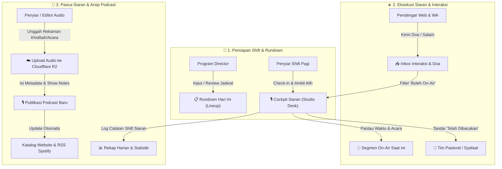
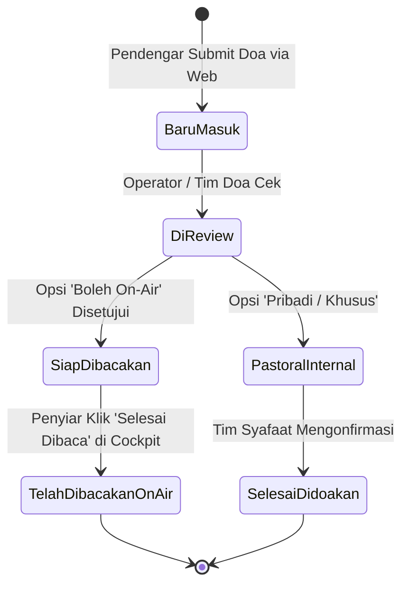

---
title: "PRD & Konsep Sistem: CMS & Dashboard Admin Radio Agape"
type: spec
tags:
  - project/radio-agape
  - cms
  - admin-dashboard
  - prd
  - broadcast-operations
created: 2026-09-08
updated: 2026-09-08
up: "[[Radio-Agape/_MOC - Radio Agape]]"
---

# 🎛️ PRD & Konsep: CMS & Broadcast Operations Dashboard
## Stasiun Radio Agape — Digital Command Center & Studio Cockpit

* **Repository GitHub**: `TrickPatMK/radio-agape-giap`
* **Status**: Draft Spesifikasi Fungsional CMS
* **Modul**: Admin CMS, Cockpit Penyiar, Operasional Rundown Harian & Podcast
* **Dokumen Terkait**: `[[Radio-Agape/_MOC - Radio Agape|MOC Radio Agape]]`, `[[Radio-Agape/PRD - Radio Agape|PRD Utama]]`, `[[Radio-Agape/Architecture - Radio Agape|Arsitektur Sistem]]`

---

## 1. Pendahuluan & Filosofi Produk

### 1.1 Visi CMS
CMS Website Radio Agape tidak dirancang sekadar sebagai *CRUD database* biasa, melainkan sebagai **Broadcast Operations Command Center (Studio Cockpit)** yang memfasilitasi ritme kerja harian stasiun radio secara terpadu:
1. **Menghubungkan Tim Manajemen (Program Director) dengan Ruang Siaran (Penyiar)**: Perencanaan jadwal mingguan dan rundown harian langsung tersaji di layar komputer studio secara *real-time*.
2. **Menghubungkan Pendengar dengan Penyiar On-Air**: Interaksi pendengar (permohonan doa, salam, request lagu) terfilter dan masuk ke layar penyiar untuk langsung direspon atau dibacakan.
3. **Penerbitan Konten Sekali Klik (*Single Workflow Publishing*)**: Rekaman khotbah atau program yang baru selesai siaran dapat langsung diunggah menjadi episode Podcast, otomatis terdistribusi ke website dan platform streaming luar (Spotify/Apple Podcasts via RSS).

---

## 2. Alur Kerja Operasional Harian (Daily Broadcast Lifecycle)



---

## 3. Modul & Kebutuhan Fungsional (CMS Functional Specifications)

### Modul 1: Cockpit Penyiar & Rundown Siaran Harian (Daily Lineup Cockpit)
Modul ini adalah halaman kerja utama (*workstation*) bagi penyiar dan operator yang sedang bertugas di studio.

* **FS-1.1 Timeline Rundown Interaktif Hari Ini**:
  * Menampilkan urutan mata acara dari pukul 00:00 s/d 23:59 untuk tanggal yang sedang berjalan.
  * Kartu acara menampilkan: Slot Jam, Nama Program, Nama Penyiar/Host, Tipe Acara (Live Talkshow, Khotbah Rekaman, Pujian Nonstop, Sesi Doa Syafaat), dan Catatan Khusus Produser (*Producer Note*).
  * Indikator status visual otomatis:
    * `🔴 ON-AIR NOW` (Program yang jamnya sedang aktif saat ini).
    * `⏳ UP NEXT` (Program berikutnya).
    * `✅ COMPLETED` (Program yang sudah lewat).
* **FS-1.2 Drag-and-Drop Sub-Segmen Rundown**:
  * Kemampuan bagi penyiar/produser untuk menyusun sub-segmen per jam siaran (misal: 06:00 Pembuka & Salam, 06:15 Renungan Firman, 06:35 Sesi Interaktif Doa, 06:50 Lagu Penutup).
* **FS-1.3 Log Catatan Siaran (Shift Logbook)**:
  * Kolom catatan studio bagi penyiar yang bertugas (contoh: "Tamu narasumber Pdt. X hadir via telepon lancar", "Request lagu terbanyak hari ini: Ku Tetap Setia").
  * Rekap shift tersimpan otomatis untuk bahan evaluasi mingguan.

---

### Modul 2: Manajemen Jadwal Induk Siaran (Master Schedule & Calendar Engine)
Digunakan oleh *Program Director* untuk mengatur pola siaran reguler dan acara khusus.

* **FS-2.1 Grid Jadwal Mingguan (Weekly Recurring Template)**:
  * Tampilan matriks 7 hari (Senin - Minggu) x 24 jam dengan sistem *time-slot blocks*.
  * Kemampuan menyalin (*duplicate*) jadwal hari kerja (Senin-Jumat) secara massal.
* **FS-2.2 Special Event Override Scheduler**:
  * Penjadwalan siaran khusus/insidental (misal: Siaran Khusus Natal 25 Des, Siaran Paskah, Siaran Langsung KKR/Seminar).
  * Penjadwalan khusus ini secara otomatis menimpa (*override*) jadwal reguler hanya pada tanggal & jam yang ditentukan tanpa merusak template mingguan.
* **FS-2.3 Penugasan Penyiar & Host Pengganti**:
  * Pengaturan penugasan penyiar tetap per program serta fitur *Substitute Announcer* jika penyiar utama berhalangan hadir.

---

### Modul 3: Moderasi Permohonan Doa & Layanan Pastoral (Prayer Request Center)
Pusat interaksi untuk menjaring dan menyalurkan permohonan doa pendengar dari website dan formulir online.



* **FS-3.1 Live Prayer Ticker di Cockpit Penyiar**:
  * Daftar permohonan doa terupdate secara otomatis (*real-time WebSocket/SSE*) tanpa perlu merefresh halaman.
  * Tombol aksi cepat bagi penyiar: `[Sedang Dibacakan]` dan `[Tandai Selesai]`.
* **FS-3.2 Klasifikasi & Filter Lanjutan**:
  * Filter berdasarkan kategori: *Kesehatan/Kesembuhan, Keluarga/Pernikahan, Finansial/Pekerjaan, Studi, Jiwa/Spiritual*.
  * Filter status: *Baru, Disetujui Siaran, Rahasia/Pastoral Only, Arsip Selesai*.
* **FS-3.3 Quick Contact WhatsApp Response**:
  * Tombol 1-klik untuk membuka WhatsApp Web dengan template balasan resmi tim pastoral ("*Shalom Bpk/Ibu [Nama], permohonan doa Anda telah kami bawa dalam doa di Radio Agape...*").

---

### Modul 4: Manajemen Podcast & Audio on Demand (AOD CMS)
Portal penerbitan rekaman program dan khotbah agar jemaat dapat mendengarkan kembali kapan saja.

* **FS-4.1 Direct-to-Storage Chunked Audio Uploader**:
  * Pengunggahan file audio (.mp3, .m4a, .aac) langsung ke Cloudflare R2 / S3 Storage dengan progress bar dan validasi format.
  * Auto-extract metadata durasi (menit:detik) dan ukuran file.
* **FS-4.2 Episode Metadata Editor**:
  * Input: Judul Episode, Nomor Episode/Musim, Nama Pembicara (*Speaker*), Ayat Alkitab Rujukan (*Scripture References*), Tanggal Khotbah, Ringkasan/Transkrip (*Show Notes* berformat Rich-Text/Markdown).
  * Pemilihan Seri/Kategori (misal: Seri Bahtera Keluarga, Seri Iman & Harapan, Khotbah Minggu).
* **FS-4.3 Artwork / Cover Uploader**:
  * Generator thumbnail otomatis atau unggah gambar persegi (1400x1400 s/d 3000x3000 px sesuai standar Apple Podcasts / Spotify).
* **FS-4.4 Sinkronisasi Otomatis ke RSS Feed**:
  * Setiap episode yang diterbitkan (*Published*) otomatis memperbarui feed `/api/podcast/rss.xml` sehingga agregator Spotify dan Apple Podcasts mendeteksi episode baru dalam hitungan menit.

---

### Modul 5: Monitoring Siaran & Analytics Sederhana (Station Health & Metrics)

* **FS-5.1 Live Streaming Pulse**:
  * Menampilkan indikator status server siaran Icecast/AzuraCast (Active / Offline).
  * Jumlah pendengar siaran langsung saat ini (*Current Concurrent Listeners*) dan puncak pendengar harian (*Peak Daily Listeners*).
  * Bitrate dan mount point siaran yang aktif.
* **FS-5.2 Podcast Listening Metrics**:
  * Total pemutaran (*Plays/Downloads*) per episode dan per seri.
  * Grafik episode terpopuler dalam 30 hari terakhir.
* **FS-5.3 Prayer Request Stats**:
  * Grafik jumlah pokok doa yang masuk per minggu dan breakdown kategori kebutuhan doa jemaat.

---

### Modul 6: Manajemen Tim & Kontrol Akses (Role-Based Access Control / RBAC)

| Peran (Role) | Hak Akses Utama | Batasan |
| :--- | :--- | :--- |
| **Super Admin / Station Manager** | Akses penuh seluruh modul: Konfigurasi website, pengelolaan akun staf, laporan analitik, pengaturan streaming server. | Tidak ada batasan. |
| **Program Director (Produser)** | Mengatur jadwal siaran mingguan, menyusun rundown harian, mengelola profil penyiar, moderasi konten podcast. | Tidak dapat mengubah konfigurasi sistem atau menghapus user admin lain. |
| **Penyiar / Host (Announcer)** | Membuka Cockpit Harian, melihat rundown hari ini, membaca dan menandai permohonan doa yang masuk saat siaran, menulis logbook siaran. | Hanya dapat melihat rundown hari bertugas, tidak dapat mengedit jadwal induk atau pengaturan teknis. |
| **Tim Pastoral / Doa (Care Team)** | Mengakses modul Permohonan Doa, memfilter pokok doa rahasia/pribadi, mencatat status konseling pastoral. | Tidak memiliki akses ke rundown siaran atau file audio podcast. |

---

## 4. Konsep Antarmuka Pengguna (UI/UX Layout Wireframe)

### 4.1 Layout Dashboard Terintegrasi
Struktur antarmuka menggunakan tema gelap-terang (*dark/light mode*) modern dengan aksen warna hangat khas Radio Agape:

```
+-----------------------------------------------------------------------------------------------+
| 📻 RADIO AGAPE DASHBOARD    | 🔴 ON AIR: "Embun Pagi" (06:00-08:00) | 👥 148 Listeners | 👤 Profil |
+-----------------------------------------------------------------------------------------------+
| [NAVIGATION]     | [MAIN WORKSPACE AREA]                                                      |
|                  |                                                                            |
| 🎙️ Cockpit Studio | 📋 RUNDOWN HARI INI: SENIN, 8 SEPTEMBER 2026                               |
| 📅 Jadwal Siaran  | +------------------------------------------------------------------------+ |
| 📥 Inbox Doa (8) | | [06:00 - 08:00] Embun Pagi | Host: Pdt. Yohanes  | 🔴 ON-AIR          | |
| 🎧 Katalog Podcast| | Catatan: Putar bumper renungan menit 15, buka sesi doa jam 07:00        | |
| 👥 Tim Penyiar    | +------------------------------------------------------------------------+ |
| 📊 Analitik      | | [08:00 - 10:00] Pujian Non-Stop | AutoDJ          | ⏳ UP NEXT         | |
| ⚙️ Pengaturan     | +------------------------------------------------------------------------+ |
|                  |                                                                            |
|                  | 📥 PERMOHONAN DOA TERBARU (LIVE FEED)                                      |
|                  | - Ibu Susan (Surabaya): "Mohon doa kesembuhan anak yang demam..." [BACA]   |
|                  | - Bpk. Daniel (Jakarta): "Urusan pekerjaan dan usaha..."          [BACA]   |
+-----------------------------------------------------------------------------------------------+
```

---

## 5. Rencana Skema Basis Data Tambahan (Database Extension Schema)

Untuk mendukung operasional harian, skema Prisma/PostgreSQL diperluas:

```prisma
// Status Rundown Acara
enum RundownStatus {
  UPCOMING
  ON_AIR
  COMPLETED
  SKIPPED
}

// Model Rundown Harian Spesifik
model DailyRundownItem {
  id              String         @id @default(cuid())
  date            DateTime       // Tanggal siaran spesifik (YYYY-MM-DD)
  startTime       String         // Format "HH:mm"
  endTime         String         // Format "HH:mm"
  title           String
  presenterName   String?
  programType     String         // Live, Recorded, Music, Prayer
  notes           String?        // Catatan khusus produser untuk penyiar
  status          RundownStatus  @default(UPCOMING)
  orderIndex      Int            @default(0)
  createdAt       DateTime       @default(now())
  updatedAt       DateTime       @updatedAt
}

// Logbook Siaran Studio
model BroadcastShiftLog {
  id              String         @id @default(cuid())
  date            DateTime
  shiftName       String         // Pagi, Siang, Sore, Malam
  announcerName   String
  issuesNote      String?        // Laporan kendala teknis (bila ada)
  highlights      String?        // Hal-hal menarik selama siaran
  createdAt       DateTime       @default(now())
}
```

---

## 6. Pembagian Implementasi Antar Tim Agen

* **🌸 Ayca (Antigravity - PC Lokal)**:
  * Pembuatan komponen antarmuka admin menggunakan **Tailwind CSS + Shadcn UI** (Dashboard Shell, Rundown Timeline Card, Prayer Inbox Ticker, Audio Uploader Dropzone).
  * Interaktivitas sisi klien: Drag-and-drop rundown reordering, optimasi performa form input.
* **💻 Ayi (Antigravity - VPS)**:
  * Implementasi Server Actions & API Route Handlers untuk sinkronisasi Rundown Harian dan status Doa.
  * Konfigurasi webhook notifikasi dan integrasi upload Cloudflare R2 presigned URLs.
  * Proteksi route otentikasi admin (menggunakan NextAuth / Better Auth / Supabase Auth).
* **👑 Bro Gen (Hermes - VPS)**:
  * Konfigurasi Icecast status endpoint polling (menarik data *listeners count* dan *current stream metadata* secara aman).
