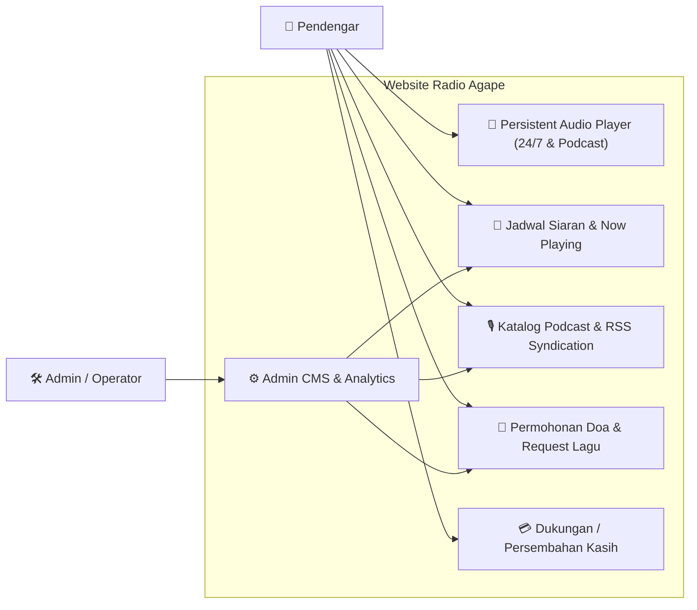
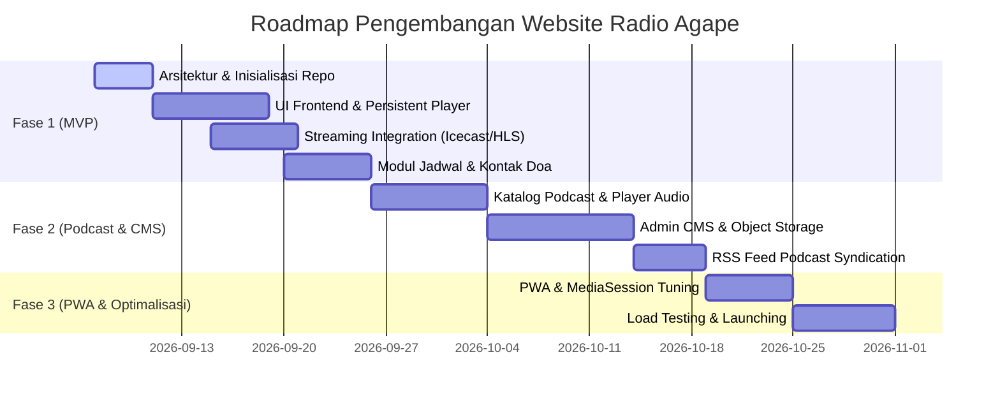

---
title: "Product Requirements Document (PRD) - Website Radio Agape"
type: spec
tags:
  - project/radio-agape
  - spec
  - prd
created: 2026-09-07
updated: 2026-09-07
up: "[[Radio-Agape/_MOC - Radio Agape]]"
---

# 📄 Product Requirements Document (PRD)
## Website Radio Agape: Platform Streaming Audio 24/7 & Podcast Terintegrasi

* **Repository GitHub**: `TrickPatMK/radio-agape-giap`
* **Status**: Draft / Review Arsitektur
* **Target Rilis Tahap 1 (MVP)**: Q4 2026
* **Penanggung Jawab Arsitektur**: Ayca (PC Lokal), Ayi (VPS), Bro Gen (Server Ops)
* **Dokumen Terkait**: `[[Radio-Agape/_MOC - Radio Agape|MOC Radio Agape]]`, `[[Radio-Agape/Architecture - Radio Agape|Arsitektur Sistem]]`

---

## 1. Latar Belakang & Visi Produk

### 1.1 Latar Belakang
Radio Agape adalah media penyiaran rohani dan komunitas yang menjangkau pendengar dengan konten inspiratif, firman, renungan, musik pujian, dan program interaktif. Di era mobilitas digital saat ini, pendengar tidak lagi hanya mengandalkan perangkat radio FM konvensional, melainkan mengakses siaran melalui ponsel pintar, tablet, dan laptop dari berbagai kota maupun luar negeri.

### 1.2 Visi & Tujuan
Membangun platform website modern, cepat, dan ramah pengguna yang berfungsi sebagai pusat siaran digital Radio Agape dengan dua pilar utama:
1. **Streaming Audio 24/7 Real-Time**: Siaran langsung non-stop dengan pemutar audio persisten (*persistent mini-player*) yang tidak terputus saat pengguna menjelajahi halaman lain.
2. **Podcast & Audio-on-Demand (AOD)**: Arsip renungan, khotbah berseri, dan rekaman program siaran yang dapat didengarkan kapan saja dengan fitur kontrol audio lengkap dan sindikasi RSS (Spotify / Apple Podcasts).
3. **Pemberdayaan Komunitas**: Menghadirkan jembatan doa (Prayer Request), salam pendengar, serta wadah donasi/persembahan kasih secara transparan dan mudah.

---

## 2. Target Pengguna & Persona

| Persona | Profil & Kebiasaan | Kebutuhan Utama |
| :--- | :--- | :--- |
| **Ibu Maria (55 th)** *Pendengar Setia di Rumah* | Mengakses via smartphone Android atau tablet, menyalakan radio saat beraktivitas di pagi hari atau saat saat teduh. | Tombol putar besar (*one-tap play*), suara jernih tanpa putus, jadwal siaran yang mudah dibaca, dan fitur kirim pokok doa yang sederhana. |
| **Kevin (24 th)** *Mahasiswa / Pekerja Muda* | Mengakses via HP saat komuter atau di kantor, multitasking membuka banyak tab/halaman. | Audio tidak terputus saat pindah halaman (*persistent player*), kontrol audio di lock screen (*MediaSession API*), katalog podcast untuk didengar on-demand. |
| **Pdt. Jonathan (45 th)** *Pembicara / Gembala* | Ingin khotbah dan seri renungannya tersimpan rapi dan dapat dibagikan dengan mudah ke jemaat. | Link shareable per episode podcast, deskripsi materi/ayat Alkitab, dan syndication RSS feed ke Spotify. |
| **Tim Siaran / Admin** | Mengelola jadwal siaran harian, mengunggah audio podcast, dan membaca permohonan doa pendengar. | Dashboard admin yang intuitif, upload file audio cepat, serta sistem moderasi permohonan doa. |

---

## 3. Fitur Utama & Kebutuhan Fungsional (Functional Requirements)

### 3.1 Modul Live Audio Streaming 24/7
* **FR-1.1 Persistent Floating Mini-Player**:
  * Pemutar audio tetap aktif di bagian bawah layar (*bottom dock*) selama navigasi antar halaman (SPA / Single Page Architecture).
  * Kontrol: Play, Pause, Mute/Unmute, Slider Volume.
* **FR-1.2 ICY Metadata & Now Playing Display**:
  * Menampilkan nama program siaran yang sedang on-air, judul lagu/artis, atau pembicara yang sedang aktif.
  * Status indikator langsung: badge visual merah `● LIVE ON AIR` berkedip halus.
* **FR-1.3 Auto-Reconnect & Resilient Buffering**:
  * Mekanisme *retry* cerdas jika koneksi internet pendengar sempat terputus atau beralih dari Wi-Fi ke data seluler tanpa membebani browser.
* **FR-1.4 Lock Screen & Background Play (MediaSession API)**:
  * Terintegrasi dengan kontrol audio sistem operasi (Android, iOS, Windows, macOS). Menampilkan cover artwork Radio Agape, judul siaran, dan tombol play/pause di lock screen / notification center.

### 3.2 Modul Podcast & Audio on Demand (AOD)
* **FR-2.1 Katalog & Pencarian Episode**:
  * Daftar episode podcast yang dapat difilter berdasarkan Seri, Kategori (Renungan, Khotbah, Keluarga, Pemuda), dan Pembicara (Speaker).
  * Fitur pencarian instan berbasis teks untuk judul atau topik pembahasan.
* **FR-2.2 Advanced Podcast Player**:
  * Kecepatan putar variabel (0.75x, 1.0x, 1.25x, 1.5x, 2.0x).
  * Lompat audio: Mundur 10 detik (*Rewind 10s*) dan Maju 30 detik (*Skip 30s*).
  * Bar durasi audio interaktif (*scrubbing bar* dengan timestamp).
  * Penyimpanan posisi terakhir (*resume listening* via LocalStorage).
* **FR-2.3 RSS Feed Generation**:
  * Menghasilkan file `/api/podcast/rss.xml` standar iTunes/Apple Podcasts dan Spotify Podcast Specification secara otomatis untuk memudahkan distribusi ke agregator luar.

### 3.3 Modul Jadwal Siaran & Panduan Program (EPG)
* **FR-3.1 Tabel Jadwal Siaran Mingguan**:
  * Tampilan jadwal siaran terstruktur per hari (Senin s/d Minggu) dengan filter hari otomatis (menampilkan hari ini secara default).
* **FR-3.2 Highlight Program**:
  * Kartu penanda untuk program yang sedang berlangsung (*Current Program*) dan program berikutnya (*Up Next*).
* **FR-3.3 Detail Program & Profil Penyiar**:
  * Informasi deskripsi acara, nama penyiar/host, dan waktu siaran rutin.

### 3.4 Modul Interaksi Pendengar & Komunitas
* **FR-4.1 Formulir Permohonan Doa (Prayer Request)**:
  * Formulir kirim pokok doa dengan kolom: Nama, Lokasi/Kota, No. WhatsApp (opsional), Pokok Doa.
  * Opsi privasi: "*Doakan secara pribadi oleh tim doa*" vs "*Boleh dibacakan di udara oleh penyiar*".
  * Konfirmasi instan & notifikasi webhook ke tim pastoral / operator siaran.
* **FR-4.2 Request Lagu & Salam Siaran**:
  * Fitur titip salam atau request lagu yang terhubung langsung ke tombol pintas WhatsApp Siaran Radio Agape.

### 3.5 Modul Dukungan / Persembahan Kasih (Giving)
* **FR-5.1 Informasi Rekening Bank**:
  * Nomor rekening resmi yayasan/gereja/stasiun radio dengan tombol *One-Click Copy*.
* **FR-5.2 QRIS Dinamis / Statis**:
  * Menampilkan barcode QRIS resmi yang dapat di-scan oleh seluruh aplikasi e-wallet (GoPay, OVO, Dana) dan mobile banking (BCA, Mandiri, BRI, dll).

### 3.6 Modul CMS Pengelola (Admin Portal)
* **FR-6.1 Manajemen Podcast**:
  * Unggah berkas audio (.mp3, .m4a) ke Cloud Object Storage.
  * Form metadata: Judul, Pembicara, Tanggal, Ringkasan / Catatan Khotbah (Show Notes), Durasi audio, dan Cover Image.
* **FR-6.2 Manajemen Jadwal Acara**:
  * CRUD jadwal program rutin dan event siaran khusus.
* **FR-6.3 Moderasi Pokok Doa**:
  * Dashboard tabel permohonan doa masuk dengan status: *Pending*, *Dibacakan*, *Didoakan*.
* **FR-6.4 Statistik Pendengar Ringkas**:
  * Metrik estimasi jumlah pemutaran podcast dan log pendengar aktif streaming.

---

## 4. Kebutuhan Non-Fungsional (Non-Functional Requirements)

1. **Performa & Latensi Audio**:
   * Initial buffer streaming audio harus berbunyi dalam waktu $< 2$ detik pada jaringan seluler 4G standar.
   * Player shell harus ringan, Core Web Vitals (LCP $< 2.5$s, CLS $< 0.1$, INP $< 200$ms).
2. **Dukungan Progressive Web App (PWA)**:
   * Pengguna dapat memasang website ke layar utama smartphone (*Add to Home Screen*) dengan icon dan splash screen Radio Agape.
   * Shell aplikasi di-cache untuk pemuatan instan secara offline.
3. **Aksesibilitas (A11y)**:
   * Memenuhi standar WCAG 2.1 Level AA.
   * Kontras warna yang cukup, teks dapat diatur ukurannya, tombol play/pause memiliki label ARIA yang jelas bagi pembaca tunanetra (*screen readers*).
4. **Efisiensi Data Seluler**:
   * Stream audio disajikan dengan format kompresi efisien (AAC 64-96 kbps untuk hemat kuota dan MP3 128 kbps untuk kualitas prima).
5. **Keamanan**:
   * Seluruh lalu lintas data dan audio stream wajib berjalan di atas HTTPS/TLS 1.3 (bebas dari error *Mixed Content* browser modern saat memutar stream audio).
   * Rate limiting pada endpoint form permohonan doa untuk mencegah spam bot.

---

## 5. Rencana Fase Rilis (Roadmap)

* **Fase 1 (MVP - Siaran Langsung & Jadwal)**:
  * Website responsif dengan Next.js & Tailwind CSS.
  * Floating persistent audio player untuk stream radio 24/7.
  * Jadwal siaran mingguan & badge Now Playing.
  * Halaman Permohonan Doa & tombol WhatsApp siaran.
* **Fase 2 (Podcast & Admin CMS)**:
  * Halaman katalog podcast dengan audio player canggih (speed control, scrub).
  * Dashboard admin terproteksi untuk unggah podcast dan kelola jadwal.
  * Endpoint generator RSS Podcast untuk syndication.
* **Fase 3 (PWA, Analytics & Polishing)**:
  * Dukungan install PWA di ponsel (Android/iOS).
  * Analytics pendengar dan optimasi performa edge CDN.

---

## 6. Metrik Keberhasilan (KPIs)

1. **Streaming Stability**: Uptime siaran audio $\ge 99.5\%$.
2. **Audio Engagement**: Durasi rata-rata mendengarkan per sesi $\ge 25$ menit.
3. **Podcast Adoption**: Minimal 500 pemutaran episode podcast per bulan.
4. **Community Response**: Minimal 30 pokok doa atau salam interaksi diterima setiap minggu.
